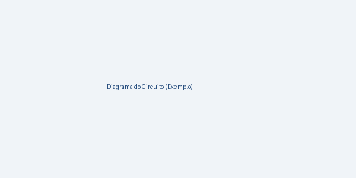

# UNIVERSIDADE DO OESTE DE SANTA CATARINA
**Campus Chapecó · Curso de Sistemas de Informação**  
**25830 · Introdução ao Hardware / Arquitetura de Hardware**

---

<br><br>

# RELATÓRIO TÉCNICO
## <<Nome do Projeto>>
### Projeto Prático — Sensor + Atuador com Arduino/ESP32
**Atividade Avaliativa**

<br><br>

**Integrantes:**
- <<Nome completo do integrante 1>>
- <<Nome completo do integrante 2>>
- <<Nome completo do integrante 3>>
- <<Nome completo do integrante 4>>

**Professor:** Jacson Luiz Matte  
**Local e Data:** Chapecó - SC, <<Mês>> de 2026

---

## Resumo
> *<<Em até 8 linhas: qual problema o projeto resolve, quais sensores e atuadores foram usados, qual placa (Arduino Uno ou ESP32) e qual foi o resultado. Escreva por último, quando tudo estiver pronto.>>*

- **Vídeo demonstrativo:** [https://<<link-do-video>>](https://<<link-do-video>>)
- **Código-fonte completo:** [https://<<link-do-repositorio-ou-tinkercad>>](https://<<link-do-repositorio-ou-tinkercad>>)
- **Circuito no Tinkercad (se houver):** [https://www.tinkercad.com/things/<<id>>](https://www.tinkercad.com/things/<<id>>)

---

## 1. Introdução e Problema
<<Que situação do dia a dia o projeto ataca? Quem seria o usuário? Por que um sensor e um atuador resolvem isso? Termine com o objetivo do projeto em uma frase.>>

---

## 2. Pesquisa: Projetos de Referência
<<Liste de 2 a 4 projetos encontrados na internet que inspiraram o de vocês. Para cada um: o que ele faz, o que vocês aproveitaram e o que decidiram fazer diferente. Cite a fonte na seção de Referências.>>

---

## 3. Componentes Utilizados

| Componente | Função no Projeto | Pino(s) | Qtde |
| :--- | :--- | :--- | :--- |
| Arduino Uno / ESP32 | Placa de desenvolvimento | -- | 1 |
| <<Sensor>> | <<O que ele mede>> | <<A0>> | 1 |
| <<Atuador>> | <<O que ele faz>> | <<9>> | 1 |
| <<Resistor 220 $\Omega$>> | <<Limita corrente do LED>> | -- | 1 |

---

## 4. Diagrama do Circuito
<<Insira a imagem do circuito: print do Tinkercad ou esquema desenhado. Toda ligação do código precisa aparecer aqui, com os pinos legíveis.>>


*Figura 1: Diagrama de ligações do projeto.*

---

## 5. Funcionamento
<<Descreva o comportamento do sistema como uma sequência: o que o sensor lê, que decisão o código toma e o que o atuador faz. Um fluxograma simples ajuda muito.>>

---

## 6. Código: Trechos Relevantes
<<Não cole o código inteiro. Escolha os 2 ou 3 trechos que fazem o projeto ser o que é (leitura do sensor, regra de decisão, acionamento do atuador) e explique cada um em um parágrafo. O código completo vai no link da capa.>>

```cpp
// Leitura do sensor e decisão
void loop() {
  int leitura = analogRead(A0);
  if (leitura < LIMIAR) {
    digitalWrite(ATUADOR, HIGH);
  } else {
    digitalWrite(ATUADOR, LOW);
  }
  delay(200);
}
```

---

## 7. Testes e Ajustes
<<O que foi testado, o que deu errado e como foi corrigido. Registre valores medidos (limiar do sensor, tempos, distâncias).>>

| Teste | Esperado | Obtido |
| :--- | :--- | :--- |
| <<Cobrir o sensor com a mão>> | <<LED acende>> | <<OK / ajustado o limiar para 380>> |

---

## 8. Resultados, Limitações e Melhorias
<<O projeto cumpre o objetivo? O que ficou faltando? O que vocês fariam com mais uma semana?>>

---

## 9. Divisão de Tarefas

| Integrante | Responsabilidades |
| :--- | :--- |
| <<Nome 1>> | <<Pesquisa e proposta; montagem do circuito>> |
| <<Nome 2>> | <<Código do sensor; testes>> |
| <<Nome 3>> | <<Código do atuador; vídeo>> |
| <<Nome 4>> | <<Relatório; apresentação>> |

---

## 10. Referências
- <<AUTOR. Título do projeto de referência. Site, ano. Disponível em: url. Acesso em: data.>>
- ARDUINO. *Language Reference*. Disponível em: <https://www.arduino.cc/reference>. Acesso em: <<data>>.
- <<Datasheet do sensor / atuador utilizado.>>
